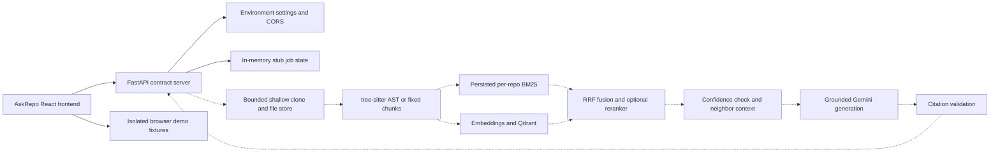

# AskRepo

Ask questions about any codebase. Get answers with exact file and line citations.

**Current checkpoint: milestone 1.** Includes an advanced React interface, isolated illustrative demos, a FastAPI contract server, Python tests, Docker skeleton, and CI. Real ingestion, retrieval, Gemini generation, evaluations, and production deployment are subsequent milestones. No indexing or retrieval benchmarks have been run.

## Frontend

React 19, TypeScript, TanStack Start, Tailwind 4, and shadcn/ui. Dark mode defaults to pure black with neutral accents; a persistent light mode is available. The interface includes:

- Repository landing page and progress view with API polling.
- Three-panel chat workspace, collapsible file tree, and mobile Chat / Code tabs.
- Markdown answers, code-block copying, clickable file/line citations, highlighted source lines, and retrieval details.
- Hybrid/reranker settings, Top K slider, local answer feedback, browser-local conversation history, and keyboard focus with Ctrl/Cmd+K.
- Seekr, CodeNest, and DPTrace demo workspaces. All three use **illustrative search-engine fixtures**, not verified contents of the named GitHub repositories. Their scores, timing values, and mode comparisons are simulated and must not be used as evaluation results.

`VITE_USE_MOCK=false` is the default: custom repository submissions and normal repository requests go to `VITE_API_BASE_URL`. Demo cards explicitly open isolated `demo:` workspaces without a backend. Set `VITE_USE_MOCK=true` to simulate custom indexing and all question/file requests for frontend development. No API key is needed for the demos or skeleton.

The supplied frontend was a blank Lovable TanStack Start starter: there was no existing application interface, `api.ts`, mock flag, product branding, or saved repository schema. The user subsequently requested the advanced interface. Page metadata lives in `src/routes/__root.tsx`, rather than `index.html`; theme values live in `src/theme.css`, imported by `src/styles.css`. A one-time legacy storage-prefix migration preserves values under `askrepo:` and removes migrated keys without overwriting newer values.

## Run locally (PowerShell)

Prerequisites: Git, Python **3.11**, Node **22.17+**, and npm. Python must be available as `python` (or substitute your Python 3.11 executable). Run from the project root:

```powershell
python -m venv .venv
.\.venv\Scripts\python.exe -m pip install -r backend\requirements-dev.txt
Copy-Item backend\.env.example backend\.env
Copy-Item frontend\.env.example frontend\.env
cd backend
..\.venv\Scripts\python.exe -m uvicorn app.main:app --reload --host 127.0.0.1 --port 7860
```

In a second terminal:

```powershell
cd frontend
npm.cmd ci
npm.cmd run dev
```

Open [AskRepo](http://localhost:5173), [interactive API docs](http://localhost:7860/docs), or [health](http://localhost:7860/health). On macOS/Linux use `.venv/bin/python` and `npm` in place of the Windows executable names; copy the example env files with `cp`.

For frontend-only development, set `VITE_USE_MOCK=true` in `frontend/.env` and restart Vite. Frontend environment variables are public build-time values; never place provider secrets there. Backend `.env` is read relative to the backend working directory and is ignored by Git.

## API contract

JSON uses camelCase. The backend matches `frontend/src/api.ts`; `/docs` is the generated OpenAPI reference.

| Endpoint | Request | Current response |
| --- | --- | --- |
| `GET /health` | — | `{status:"ok", service:"askrepo", mode:"stub"}` |
| `POST /index` | `{repoUrl}` | `{jobId,repoId}`; validates the HTTPS GitHub URL without fetching it |
| `GET /index/{jobId}` | — | `{status,filesParsed,chunksCreated,error?}`; stub ends in `failed` with an explicit unimplemented message |
| `POST /ask` | `{repoId,question,topK?:8,hybrid?:true,rerank?:true}` | `{answer,citations:[],chunks:[],notFound:true,latencyMs:{retrieve:0,rerank:0,generate:0}}` for a known stub repo |
| `GET /file` | `?repoId=…&path=…` | `404`: file storage is not implemented; no submitted filesystem path is opened |
| `GET /repos` | — | `[]`: failed jobs are not represented as indexed repositories |

Unknown job/repo identifiers return `404`. Invalid requests return `422`. Questions must contain non-whitespace text, be at most 500 characters, and use Top K between 1 and 50 (the UI offers 3–20). The short frontend reference prompt omitted `repoId` from the indexing response and omitted `notFound`/`latencyMs` from answers; these fields follow the original backend specification so polling and confidence states have a complete contract. No streaming endpoint is used: the UI animates completed responses locally.

Browser mock mode offers a local `api.compare()` helper for side-by-side illustrative BM25/vector/hybrid rankings. There is no real comparison endpoint in this checkpoint; the UI explains its demo-only availability. Independent backend evaluations are scheduled for milestone 6.

## Architecture

Solid connections exist in this checkpoint; dashed connections describe planned backend work.



## Configuration

See `backend/.env.example` for all current settings. App-specific variables use `ASKREPO_`; provider conventions retain `GEMINI_API_KEY`, `QDRANT_URL`, `QDRANT_API_KEY`, and `LITE_MODE` as required by the specification. CORS origins are an explicit JSON array, such as `["http://localhost:5173","https://your-frontend.vercel.app"]`. Secrets use Pydantic `SecretStr` and are never returned by API responses.

Provider/model settings are reserved for later milestones. The skeleton does not load embedding/reranker models or call paid services.

## Checks

From the repository root:

```powershell
.\.venv\Scripts\python.exe -m ruff check backend
.\.venv\Scripts\python.exe -m pytest -q backend
cd frontend
npm.cmd test
npm.cmd run typecheck
npm.cmd run build
```

Browser checks use the installed Microsoft Edge browser on Windows. On other hosts install the test browser once with `npx playwright install chromium`. With the backend running, all browser checks exercise the full skeleton integration; otherwise the live-backend check is explicitly skipped:

```powershell
cd frontend
npm.cmd run test:e2e
```

GitHub Actions runs Ruff, pytest, frontend unit tests, type checking, and a production build. Tests require no model downloads, GPU, or provider keys. `.npmrc` enables legacy peer resolution to work around the starter's npm peer-graph resolution failure; the committed npm lockfile makes `npm ci` reproducible.

## Evaluation results

No evaluation numbers are claimed. This table will be populated only from actual `run_eval.py` output in milestone 6, after the ground truth is reviewed.

| Chunking | Retrieval | Recall@1 | Recall@5 | Recall@10 | MRR | Mean latency |
| --- | --- | --- | --- | --- | --- | --- |
| Not run | Not run | — | — | — | — | — |

## Docker and deployment

The skeleton runs on port 7860 as a non-root user:

```powershell
docker build -t askrepo ./backend
docker run --rm -p 7860:7860 --env-file backend/.env askrepo
```

Docker runtime verification requires a running Docker daemon. Full Hugging Face Spaces, Vercel, Qdrant Cloud deployment instructions, pre-downloaded CPU models, lightweight mode implementation, and demo pre-indexing scripts are scheduled for milestone 7. Do not deploy this stub as a functioning RAG backend. The retained TanStack Start starter currently builds a Cloudflare/Nitro target; its Vercel adapter must be configured and tested before that deployment.

## Milestones and limitations

1. Product naming, advanced frontend, API skeleton, settings, Docker, tests, CI — current checkpoint.
2. Safe ingestion and AST chunking.
3. BM25, vectors, and hybrid RRF retrieval.
4. Reranker, neighbor context, and confidence gate.
5. Gemini generation, grounded prompts, and citation validation.
6. Evaluation harness, manually reviewed question sets, real result table, citation validity checks.
7. End-to-end hardening, rate limiting, deployment, demo pre-indexing.

Current jobs are ephemeral, not persistent or queued. Real indexing deliberately fails instead of reporting fictitious progress. Public visibility/access is not checked until cloning is implemented. Rate limits, clone size limits, path containment checks against a real file store, prompt-injection defenses, and citation validation require their later implementation before exposing ingestion publicly. Browser history is local and may contain code/answers; there is no account sync. Thumbs feedback is local to the displayed answer. Demo data is illustrative and is not evaluation ground truth.
