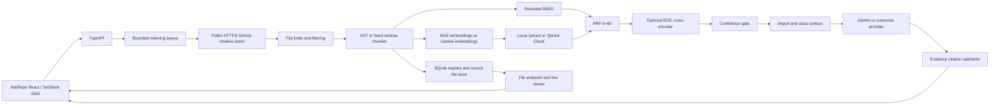

# AskRepo

Ask questions about any codebase. Get answers with exact file and line citations.

AskRepo combines AST-aware chunks, persisted BM25, local or cloud Qdrant vectors, reciprocal-rank fusion, optional cross-encoder reranking, and grounded Gemini answers. It runs on a CPU without paid services: when no Gemini key is set, it returns cited source excerpts using an explicit extractive provider.

The React interface has pure-black dark mode, a neutral light mode, indexing progress, persistent chat history, retrieval settings, independent mode comparison, a full file tree, and a responsive citation viewer. The seven core milestones and six extension milestones are implemented, including streamed answers with Stop, stateless follow-up memory, bounded agentic retrieval, quota protection, and evaluation. Local test/evaluation evidence and outstanding verification limits are recorded below. **No deployment has been performed.**

## Architecture



Indexing workers are in-process, default concurrency 1, with a bounded queue. Models are loaded lazily; **nothing is cloned or indexed on API startup**. Clones and Git metadata are removed after the filtered source store and chunks have been saved. Completed repo metadata, source files, BM25, and local Qdrant survive restarts. Interrupted indexing is marked failed; indexing jobs themselves are ephemeral.

## Local setup

Prerequisites: Python **3.11**, Git, Node **22.17+**, npm, and network access for the initial public model downloads. Full mode is intended for a CPU host with approximately 16 GB RAM. A memory-saving int8 profile is also available; lightweight mode avoids local neural models entirely.

PowerShell, from the project root:

```powershell
python -m venv .venv
.\.venv\Scripts\python.exe -m pip install "torch>=2.6,<3" --index-url https://download.pytorch.org/whl/cpu
.\.venv\Scripts\python.exe -m pip install -r backend\requirements.txt -r backend\requirements-dev.txt
Copy-Item backend\.env.example backend\.env
Copy-Item frontend\.env.example frontend\.env
cd backend
..\.venv\Scripts\python.exe -m uvicorn app.main:app --host 127.0.0.1 --port 7860
```

Second terminal:

```powershell
cd frontend
npm.cmd ci
npm.cmd run dev
```

Open [AskRepo](http://localhost:5173), [API docs](http://localhost:7860/docs), and [health](http://localhost:7860/health). If Python is installed outside PATH, substitute its Python 3.11 executable for `python`. On Linux/macOS use `python3.11`, `.venv/bin/python`, `cp`, and `npm` in place of the Windows command names. Keep the API working directory at `backend` so `.env` and relative data paths resolve consistently.

Optional explicit model prefetch:

```powershell
cd backend
..\.venv\Scripts\python.exe scripts/download_models.py
```

The default frontend uses real HTTP requests (`VITE_USE_MOCK=false`). Demo cards use already indexed repositories when available and otherwise start real indexing. To exercise only the illustrative frontend fixtures, set `VITE_USE_MOCK=true` and restart Vite. Fixture scores and answers are never included in backend evaluation results. Historical browser demo workspaces retain their explicit `demo:` namespace and banner.

## Demo preparation

Run explicitly from the project root, with the API process stopped when using local Qdrant:

```powershell
.\.venv\Scripts\python.exe scripts/preindex.py
```

This queues Seekr, CodeNest, and DPTrace, prints real stage/counter progress, and skips already indexed URLs. Use `--repos Seekr` for one repository or `--force` for new snapshots. Then start the backend; demo cards open the indexed repositories immediately. Source repositories are never executed, built, or imported.

## Configuration

See `backend/.env.example` for exact variables. Secrets belong only in the backend environment, never in `VITE_*` variables. The defaults are:

| Variable | Default / purpose |
| --- | --- |
| `ASKREPO_DATA_DIR` | `data`; registry, source snapshots, BM25, local Qdrant |
| `ASKREPO_MODEL_CACHE` | `data/models`; downloaded public weights |
| `ASKREPO_CORS_ORIGINS` | JSON array of the two local frontend origins |
| `ASKREPO_EMBEDDING_MODEL` | `BAAI/bge-small-en-v1.5` |
| `ASKREPO_RERANKER_MODEL` | `BAAI/bge-reranker-base` |
| `ASKREPO_GEMINI_MODEL` | `gemini-2.5-flash`; configurable |
| `ASKREPO_LLM_PROVIDER` | `auto`: Gemini when a key exists, otherwise source excerpts; `gemini` and `extractive` are explicit options |
| `GEMINI_API_KEY` | Optional for generation; required for lightweight embeddings |
| `QDRANT_URL`, `QDRANT_API_KEY` | Set both for Qdrant Cloud; otherwise path-based embedded Qdrant |
| `LITE_MODE` | `false`; `true` uses Gemini embeddings and skips the local reranker |
| `ASKREPO_GEMINI_EMBEDDING_MODEL` | `gemini-embedding-001`, 768 dimensions |
| `ASKREPO_QUANTIZE_MODELS` | `false`; optional dynamic int8 CPU model profile |
| `ASKREPO_QUANTIZE_LINEARS` | `true`; set false to quantize only embedding tables on older CPUs |
| `ASKREPO_MODEL_THREADS` | `4`; CPU inference threads |
| `ASKREPO_EMBEDDING_BATCH_SIZE` | `16` |
| `ASKREPO_RERANKER_BATCH_SIZE` | `4` |
| `ASKREPO_EMBEDDING_MAX_LENGTH` | `512`; bounded token budget, included in index compatibility |
| `ASKREPO_RERANKER_MAX_LENGTH` | `512` |
| `ASKREPO_CHUNK_STRATEGY` | `ast` or `fixed` |
| `ASKREPO_MAX_CHUNK_CHARS` | `6000`, approximately 1,500 tokens before tokenizer-specific truncation |
| `ASKREPO_INDEXING_CONCURRENCY` | `1` |
| `ASKREPO_MAX_QUEUED_JOBS` | `20` |
| `ASKREPO_MAX_FILE_BYTES` | `307200`; larger individual files are skipped |
| `ASKREPO_MAX_REPO_BYTES` | `104857600`; total checkout cap |
| `ASKREPO_MAX_CLONE_BYTES` | `209715200`; clone storage cap |
| `ASKREPO_MAX_FILES` | `10000` |
| `ASKREPO_CLONE_TIMEOUT_SECONDS` | `180` |
| `ASKREPO_ASK_RATE_PER_MINUTE` | `30` per peer IP; comparison costs 3 requests |
| `ASKREPO_INDEX_RATE_PER_MINUTE` | `5` per peer IP |
| `ASKREPO_MAX_REQUEST_BYTES` | `32768`; includes bounded history |
| `ASKREPO_FUSION_THRESHOLD` | `0.55` on theoretically normalized RRF |
| `ASKREPO_BM25_THRESHOLD` | `0.15` on `1-exp(-score/8)` |
| `ASKREPO_VECTOR_THRESHOLD` | `0.55` cosine similarity |
| `ASKREPO_RERANK_THRESHOLD` | `0.20` sigmoid reranker score |
| `ASKREPO_MAX_CONTEXT_CHARS` | `100000`; whole-line prompt budget |

Changing the embedding model, lightweight embedding provider, or quantization profile requires re-indexing; the API detects incompatible indexes. Scores are normalized ranking signals, not calibrated probabilities. Thresholds are configurable and require validation on the intended repository/question mix.

On a memory-constrained local CPU, set `ASKREPO_QUANTIZE_MODELS=true`, `ASKREPO_MODEL_THREADS=2`, `ASKREPO_EMBEDDING_BATCH_SIZE=4`, and `ASKREPO_RERANKER_BATCH_SIZE=2`. On this older two-core development CPU, `ASKREPO_QUANTIZE_LINEARS=false` retains fast float matrix operations while compressing the large embedding tables. The local run also sets both model token budgets to 128; production defaults remain 512. This retains both requested BGE models, every source file and all 45 questions, while changing precision and truncation budgets. The benchmark JSON records those settings explicitly; it is not a full-precision 512-token benchmark.

For a host below 1 GB, install `requirements-lite.txt`, set `LITE_MODE=true`, `GEMINI_API_KEY`, `QDRANT_URL`, and `QDRANT_API_KEY`. This avoids torch and sentence-transformers. Gemini quotas and provider availability still apply. The full local/extractive path needs no paid service.

## API

CamelCase JSON; `/docs` is the executable OpenAPI contract.

| Endpoint | Contract |
| --- | --- |
| `POST /index` | `{repoUrl}` → `{jobId,repoId}` |
| `GET /index/{jobId}` | `{status,filesParsed,chunksCreated,error?,queued}`; status is cloning/parsing/chunking/embedding/ready/failed |
| `POST /ask` | `{repoId,question,topK?:8,hybrid?:true,rerank?:true}` → `{answer,citations,chunks,notFound,latencyMs,generationMode,rerankApplied}` |
| `POST /ask/stream` | Ask body plus optional history/agentic/requestId; POST SSE status, chunks, token, answer_clean, validated citations, done, and sanitized error events |
| `GET /file?repoId=…&path=…` | `{content,language}` from the immutable source snapshot |
| `GET /repos` | Ready repositories with `repoId,repoUrl,files,chunks,indexedAt` |
| `GET /files?repoId=…` | Stored source paths/languages for the file tree |
| `POST /compare` | Ask input → independent `{bm25:[chunks],vector:[chunks],hybrid:[chunks]}` without generation |
| `GET /health` | Liveness and configured generation mode; does not trigger model downloads |

`citations` are `{path,startLine,endLine}`. Returned `chunks` add `{score,method,code}` with BM25/vector/hybrid/reranked method labels. `latencyMs` contains retrieve, rerank, and generate timings. The optional `retrievalMode` request field selects `bm25`, `vector`, or `hybrid` directly; existing `hybrid=false` requests continue to mean BM25-only. The original backend contract's `repoId`, `notFound`, and latency fields are retained even though the short frontend reference prompt omitted them. The frontend uses POST SSE for live answers and can fall back once to `/ask` for transport or unsupported-endpoint failures.

Questions are nonblank and at most 500 characters; Top K is 1–50 (the UI exposes 3–20). Unknown resources return 404, repositories not ready or indexes with incompatible settings return 409, malformed inputs return 422, queue/rate limits return 429, oversized bodies return 413, and unavailable providers return a sanitized 503. Secrets use `SecretStr` and are not returned in errors.

## Chunking, retrieval, and safety

- Python, JavaScript/JSX, TypeScript/TSX, Java, C and C++ use tree-sitter. Functions, methods, classes, nested functions, import/docstring context and oversized overlapping pieces retain inclusive one-based source ranges. Large classes expose headers and separate methods. Markdown is split at headings. Other text uses 60-line windows with 10-line overlap.
- Chunk records include ID, repo, path, language, line range, symbol, parent, code, kind and enriched `path | language | parent.symbol` text. BM25 splits camelCase/acronyms/snake_case and retains each original identifier.
- BM25 top 50 and vector top 50 run in parallel. RRF uses k=60. Optional reranking scores the top 20 candidates. Context expansion adds matching class headers and imports without turning those extra context chunks into citations.
- A low-confidence result returns `notFound=true` without an LLM call. Generation uses a separate system instruction that treats repository code/comments as untrusted data. Invalid model citations are removed; an answer with no valid evidence citation is withheld. Ranges are checked against the exact prompt evidence. Markdown HTML is escaped and remote images are not rendered.
- Clone URLs must match public `https://github.com/owner/repo` syntax; credentials, alternate hosts, ports, queries and redirects are rejected. Git uses isolated configuration, no credential helper, no repository hooks, no submodule recursion, and HTTPS only. Cloning is time/disk bounded and checkout size is checked before materialization.
- Dependencies/build folders, lockfiles, binary/image/minified/oversized files, symlinks, and environment-secret files are excluded. Repository code is never executed. File reads reject absolute/drive/UNC paths, backslashes, traversal, nulls and symlink escapes after resolution.
- Request bodies, questions, queues, cached repositories, and IP buckets are bounded. Rate limiting uses the actual ASGI peer, not untrusted forwarding headers. Docker disables proxy-header trust by default. A future reverse-proxy setup must explicitly configure trusted proxy addresses.

## Evaluation and manual review

The harness compares fixed versus AST chunking against BM25, vector, hybrid RRF, and hybrid + rerank: **8 configurations, 45 draft questions, 3 public repository snapshots**. Embeddings and reranking use the actual BGE models on CPU. Each result includes per-question rankings, metrics, model/library versions, source revisions, question hashes, precision/batch settings, and index stats.

**Every draft label still needs your review:** `seekr-01` through `seekr-15`, `codenest-01` through `codenest-15`, and `dptrace-01` through `dptrace-15`. Verify the expected paths and symbols, add other relevant targets where needed, remove ambiguous questions, then set `reviewed:true` in each JSONL row. Path-only labels deserve special scrutiny because they accept any chunk from that file. See [evaluation instructions](backend/eval/README.md) and [the review checklist](backend/eval/REVIEW.md). Draft baseline numbers are not a human-validated benchmark.

From `backend`:

```powershell
..\.venv\Scripts\python.exe -m eval.prepare
..\.venv\Scripts\python.exe -m eval.run_eval --validate-only
..\.venv\Scripts\python.exe -m eval.run_eval
# After reviewing all 45 rows:
..\.venv\Scripts\python.exe -m eval.run_eval --require-reviewed
$latestRun = Get-ChildItem eval/results -Filter "????-??-??.json" | Sort-Object Name -Descending | Select-Object -First 1
..\.venv\Scripts\python.exe -m eval.faithfulness --results $latestRun.FullName
```

Recall counts unique relevant path/symbol targets, using line overlap resolved independently with AST labels so fixed chunks are scored fairly. MRR is evaluated within the returned top ten, explicitly shown as MRR@10. Hit rate@10 means at least one relevant result. Mean query latency includes retrieval and enabled reranking; model loading and indexing are recorded separately. A seeded 20-answer citation spot-check reports both coverage and structural citation validity. It does not establish semantic entailment or answer correctness; its default extractive provider makes no Gemini call.

This first run is a single pass on an interactive development laptop, sharing CPU and memory with other applications and local checks. Timings describe that observed environment. Use an idle host and repeated runs before making production performance claims.

<!-- ASKREPO:EVAL:START -->
Ground truth: **draft—human review required**. Actual CPU run: `2026-11-02.json`.

| Chunking | Retrieval | Recall@1 | Recall@5 | Recall@10 | MRR@10 | Hit rate@10 | Avg ms |
| --- | --- | ---: | ---: | ---: | ---: | ---: | ---: |
| fixed | bm25 | 0.2667 | 0.4000 | 0.5556 | 0.3380 | 0.5556 | 6.63 |
| fixed | vector | 0.2667 | 0.6000 | 0.7333 | 0.4226 | 0.7333 | 146.79 |
| fixed | hybrid | 0.3111 | 0.6444 | 0.7333 | 0.4332 | 0.7333 | 176.36 |
| fixed | hybrid + rerank | 0.2444 | 0.6000 | 0.7778 | 0.4120 | 0.7778 | 38022.03 |
| ast | bm25 | 0.1556 | 0.3111 | 0.4889 | 0.2214 | 0.4889 | 17.33 |
| ast | vector | 0.2222 | 0.5778 | 0.7111 | 0.3687 | 0.7111 | 152.82 |
| ast | hybrid | 0.2000 | 0.5333 | 0.6000 | 0.3128 | 0.6000 | 217.68 |
| ast | hybrid + rerank | 0.1778 | 0.4667 | 0.6667 | 0.3174 | 0.6667 | 29106.79 |
<!-- ASKREPO:EVAL:END -->

In the recorded draft/128-token run, fixed-window hybrid + rerank had the highest Recall@10 (**0.7778**). Fixed-window hybrid without reranking had the highest MRR@10 (**0.4332**) at **176.36 ms** average observed query latency. AST chunking did not improve the aggregate retrieval-quality metrics in this run. Reranking cost about **38.0 s** per fixed-window query and **29.1 s** per AST query on this development machine. These are measured baseline findings, not evidence that the defaults are optimal. Review the labels and repeat with the intended model profile before tuning.

The seeded extractive citation audit sampled **20 answers**, all of which contained citations, and checked **60 citations: 60 valid (100%)**, with no not-found answers in that sample. This establishes file/range validity only, not semantic faithfulness or Gemini answer quality. See [the complete retrieval report](backend/eval/results/2026-11-02.json) and [the citation audit](backend/eval/results/2026-11-02-citation-audit.json).

## Streaming, chat memory, and free-tier controls

See [the transport and deployment guide](backend/STREAMING.md) for event payloads and exact behavior. The frontend calls the backend URL directly using POST fetch and ReadableStream, including when hosted on Vercel. The server sends 15-second heartbeat comments and disables response buffering. Sources arrive before generation; citation objects arrive only after validation. Stop aborts the request, and an interrupted response stays marked as incomplete after reload.

Requests can include `history: [{role,content}]`, `agentic`, and an optional `requestId`. The browser sends its last six completed messages; the server bounds history to six messages and 6,000 characters, with assistant messages truncated to 1,200 characters. Standalone questions skip rewriting. Follow-ups search a standalone query but answer the original question using recent history and current evidence. Old citations never become valid merely because they appear in history. New chat starts without history.

`/ask` defaults agentic to false; `/ask/stream` defaults it to true. **The UI keeps agentic retrieval opt-in.** Strong ranking signals skip the model grader. Weak evidence can trigger one retry with at most two alternative queries, merged by RRF and optionally reranked. Still-weak results return not-found with the closest sources. Rewriting and grading use the configurable fast model; only the final answer uses the answer model. No-key mode uses deterministic history context, lexical query variants, and source excerpts; it does not claim Gemini rewrite/grader behavior.

Every provider attempt, including retries, shares `MAX_LLM_CALLS_PER_QUESTION` (default 3). Optional steps reserve a final answer call. SDK automatic retries are disabled. The wrapper allows at most two retries for 429/5xx, with backoff, a global minute limit, a peer-IP limit, and a bounded short-wait queue. Explicit quota errors display "Demo limit reached, try again in a minute". The frontend reuses a request ID for compatible stream/fallback attempts, preventing a second request from resetting its call budget. A missing streaming endpoint uses the older JSON shape for compatibility.

Validated complete answers have a bounded ten-minute in-memory cache. Keys include snapshot, normalized rewritten question, retrieval/model settings, original question and bounded-history digest. Cache hits replay the normal stream without new model calls. Errors and stopped answers are not cached. `totalMs` includes rewrite, grading and queue time; the original retrieve/rerank/generate latency fields remain available.

| Variable | Default / purpose |
| --- | --- |
| `GEMINI_FAST_MODEL` | `gemini-2.5-flash-lite`; rewrite and weak-result grading |
| `GEMINI_ANSWER_MODEL` | Optional; otherwise existing `ASKREPO_GEMINI_MODEL` |
| `MAX_LLM_CALLS_PER_QUESTION` | `3`; hard provider-attempt cap |
| `AGENTIC_ENABLED` | `true`; server-wide off switch when false |
| `ASKREPO_AGENTIC_GOOD_SCORE` / `ASKREPO_AGENTIC_LOWER_SCORE` | `0.65` / `0.35`; ranking-rule thresholds |
| `ASKREPO_LLM_GLOBAL_RPM` / `ASKREPO_LLM_PER_IP_RPM` | `10` / `6` |
| `ASKREPO_LLM_QUEUE_WAIT_SECONDS` / `ASKREPO_LLM_MAX_QUEUED` | `2` / `32` |
| `ASKREPO_LLM_MAX_RETRIES` / `ASKREPO_LLM_RETRY_BACKOFF_SECONDS` | `2` / `0.5` |
| `ASKREPO_ANSWER_CACHE_SIZE` / `ASKREPO_ANSWER_CACHE_TTL_SECONDS` | `128` entries / `600` seconds; size 0 disables caching |

For future Spaces/Vercel hosting, set `VITE_API_BASE_URL` to the Space URL and add the exact Vercel origin to `ASKREPO_CORS_ORIGINS`; stream POSTs share the same CORS policy. Keep secrets in the backend. Do not route SSE through a Vercel serverless function. Free-tier quotas vary by project/model; these controls bound usage but cannot guarantee provider availability. Cache, counters and request-ID budgets are per process and reset on restart. `llmCalls` counts text-provider attempts, not embedding requests or CPU inference. Lightweight mode also consumes Gemini embedding quota. No deployment has been performed.

The original 45 questions and all 15 new follow-up cases (`followup-seekr-01`–`05`, `followup-codenest-01`–`05`, `followup-dptrace-01`–`05`) require manual review. Follow-up histories are authored drafts, not recorded model outputs. Verify the history, call sites and path/symbol targets in [the complete checklist](backend/eval/REVIEW.md).

From `backend`, after explicitly indexing compatible snapshots:

```powershell
..\.venv\Scripts\python.exe -m eval.run_eval --suite advanced --validate-only
..\.venv\Scripts\python.exe -m eval.run_eval --suite advanced --share-initial --provider extractive
# After setting a Gemini key and selecting auto/gemini generation:
..\.venv\Scripts\python.exe -m eval.run_eval --suite advanced --provider configured --delay-seconds 20
```

The paired option measures one initial hybrid/reranked search and adds each branch's measured continuation; it records both components explicitly. Omit `--share-initial` for independent full executions. Follow-up comparisons use hybrid retrieval without reranking in both modes unless `--followup-rerank` is supplied. Caching is disabled for evaluation. A no-key run reports actual CPU/offline behavior and zero text-provider calls; it must not be described as measured Gemini quality. The script updates a separate results table only after the full run succeeds.

A running API owns its embedded Qdrant directory. To evaluate without stopping it, create an isolated consistent copy:

```powershell
..\.venv\Scripts\python.exe -m eval.snapshot --output data/eval-copy
..\.venv\Scripts\python.exe -m eval.run_eval --suite advanced --share-initial --advanced-data-dir data/eval-copy
```

The snapshot helper uses SQLite online backups of completed immutable indexes, retains identical source files and vectors, and does not copy the live Qdrant lock. The report records snapshot provenance and corpus hashes. No source repository is modified or executed.

## Tests and local builds

Fast CI dependencies do not download neural models:

```powershell
.\.venv\Scripts\python.exe -m pip install -r backend/requirements-dev.txt
.\.venv\Scripts\python.exe -m ruff check backend scripts
.\.venv\Scripts\python.exe -m pytest -q backend
cd frontend
npm.cmd test
npm.cmd run typecheck
npm.cmd run build
npm.cmd run test:e2e
```

Tests stub the embedding model, reranker and LLM while exercising actual local Qdrant persistence, the indexing queue, file store and API. Browser tests use installed Edge on Windows; elsewhere install Playwright Chromium with `npx playwright install chromium`. They cover the black/light themes, chat history, citation viewer, settings and mobile tabs. The isolated test server uses port 4173. The live backend test requires a running local API and that test origin in its CORS array; deterministic UI tests use intercepted contract responses. Set `ASKREPO_E2E_REUSE=true` only when intentionally testing an already running AskRepo build on port 4173.

Verified locally: backend **122 passed, 1 skipped** (Windows symlink privilege), clean Ruff, frontend **17 unit tests passed**, clean TypeScript and changed-component ESLint, and successful Node and Vercel artifact builds. All **8 browser scenarios passed against the built production app**, including a real Seekr answer over SSE with no JSON fallback, working source citations, follow-up history, New chat, Stop closing a chunked HTTP connection, and opening a demo while the repository list is still loading. A fresh `octocat/Hello-World` HTTP smoke test also passed real cloning, indexing, source retrieval, cited answering, missing-evidence handling, and clone cleanup. The demo-preparation CLI recognized all three completed real demo indexes. The Vercel artifact build only prepares local files; it does not deploy. Gemini and Qdrant Cloud integrations are tested with SDK substitutes; no credentialed live call or Docker runtime check has been performed.

This workspace's ignored local `.env` points at the completed `data/eval-indexes/ast` snapshots and allows the browser-test origin on port 4173. Model weights and source/vector snapshots are generated local data. A clean clone should follow the setup and explicit pre-indexing commands above.

The default production build uses Nitro's Node server target. Start it with `npm run start` after `npm run build`. `npm run build:vercel` creates local Vercel Build Output API artifacts only; it does not deploy. The npm lockfile and `.npmrc` are authoritative for the retained Lovable starter's dependency graph. CI runs backend Ruff/pytest and frontend tests/typecheck/build.

## Deployment preparation — no deployment performed

CPU Docker build, with models downloaded during the build:

```powershell
docker build -t askrepo ./backend
docker run --rm -p 7860:7860 -v askrepo-data:/data askrepo
# Lightweight image, with no local torch/model downloads:
docker build --build-arg LITE_MODE=true -t askrepo:lite ./backend
```

The image uses Python 3.11, Git, a non-root user, one Uvicorn process and port 7860. `/data` is for writable persistent snapshots; `/opt/models` is the preloaded model cache. A running Docker daemon is required for runtime verification. Do not override those container paths with the local `.env` path values.

When deployment is later authorized:

1. **Hugging Face Spaces, Docker SDK:** use `backend` as the build context (or copy its contents to the Space repository). Set Space README YAML `sdk: docker` and `app_port: 7860`. Keep `ASKREPO_DATA_DIR=/data` and `ASKREPO_MODEL_CACHE=/opt/models`; persist `/data` if snapshots should survive restarts. Set `ASKREPO_CORS_ORIGINS=["https://your-frontend.vercel.app"]`. Add `GEMINI_API_KEY` as a secret for generated answers, or use extractive mode. Add both Qdrant variables for cloud vectors. For a small host build the lite image and supply the required Gemini key. Public model downloads need no secret for these BAAI models.
2. **Qdrant Cloud:** create a free cluster, copy its HTTPS endpoint into `QDRANT_URL`, and place its API key in `QDRANT_API_KEY`. Collections are named `askrepo_<repoId>`. Source files, BM25 and the registry still need persistent backend storage; Qdrant Cloud alone does not persist them.
3. **Vercel frontend:** project root `frontend`, Node 22, build command `npm run build:vercel`, framework preset Other, output setting at the framework default (Nitro emits `.vercel/output`). Set `VITE_API_BASE_URL=https://your-space.hf.space` and `VITE_USE_MOCK=false` before building. Add that exact frontend origin to the backend CORS array. Use `scripts/preindex.py` explicitly against the intended data storage to prepare demo snapshots; startup never auto-indexes them.

References: [Spaces Docker](https://huggingface.co/docs/hub/spaces-sdks-docker), [Nitro/Vercel](https://nitro.build/deploy/providers/vercel), [Qdrant Cloud setup](https://qdrant.tech/documentation/cloud-quickstart/).

## Known limitations

There is no authentication, multi-user authorization, distributed queue or distributed rate limiter. Use one application process per embedded Qdrant directory; stop the API before running local pre-indexing against that same directory. Multiple workers need a different job architecture and shared metadata/file storage even with Qdrant Cloud. Server-side indexing state and browser chat history have different lifetimes.

Model tokenizers may truncate an approximately 1,500-token chunk: BGE and the reranker currently cap input at their supported sequence lengths. Chunk character budgets and confidence thresholds are heuristic. Dynamic int8 is an optional CPU profile and can change rankings. Draft relevance labels require human correction. Structural citation validity does not prove that a claim follows from those lines. Gemini and Gemini embedding live calls require a user-provided key and provider availability; automated tests stub them. Streaming uses the Gemini async API or explicitly labeled source excerpts. Stop closes the provider stream; a native CPU operation already running finishes before cancellation checkpoints prevent subsequent stages.

The original frontend was a blank Lovable TanStack Start starter. Product metadata is in `src/routes/__root.tsx` rather than `index.html`; theme variables are in `src/theme.css`. A one-time migration moves legacy browser keys to `askrepo:` without overwriting newer values. The advanced interface was added at the user's request; Lovable connection instructions in `frontend/AGENTS.md` are retained.


## Streaming, memory, and agentic evaluation

<!-- ASKREPO:ADVANCED:EVAL:START -->
Actual run: `2026-11-03-advanced.json`. Ground truth: **draft—human review required**. Provider: **extractive**.

Paired modes share a freshly measured initial search. Latency is that measured stage plus each measured continuation; the initial model work is not executed twice.

| Suite | Mode | N | Recall@1 | Recall@5 | Recall@10 | MRR@10 | Avg measured ms | Avg LLM calls | Retry rate | Answer rate |
| --- | --- | ---: | ---: | ---: | ---: | ---: | ---: | ---: | ---: | ---: |
| standalone | single-pass hybrid + rerank | 45 | 0.1778 | 0.4667 | 0.6667 | 0.3174 | 44942.31 | 0.00 | 0.0000 | 0.7111 |
| standalone | agentic retrieval | 45 | 0.1778 | 0.4444 | 0.6222 | 0.3060 | 70620.53 | 0.00 | 0.6889 | 0.3111 |
| follow-up | rewrite off | 15 | 0.1333 | 0.1333 | 0.2000 | 0.1400 | 143.56 | 0.00 | 0.0000 | 1.0000 |
| follow-up | rewrite on | 15 | 0.4000 | 0.8000 | 0.8667 | 0.5806 | 187.47 | 0.00 | 0.0000 | 1.0000 |

Agentic retrieval did not improve Recall@10 in this run. It remains opt-in in the UI.

Follow-up reranking: **False** in both rewrite modes. Answer caching is disabled. LLM calls count actual provider attempts, including retries.

**No Gemini key was used.** Rewriting uses prior identifiers and agentic retries use ranking rules and lexical query variants. These are real CPU/no-key results, not measured Gemini rewrite/grader quality or free-tier Gemini cost.

<!-- ASKREPO:ADVANCED:EVAL:END -->

The advanced run saved 120 question/mode records. A separate check verified all 227 saved citation ranges against both the source-file bounds and the currently retrieved spans. This establishes structural validity, not semantic answer faithfulness. The CPU run used 128-token, embedding-int8 BGE indexes; the report records the full model profile and source revisions. Review the 60 draft cases in [the relevance review checklist](backend/eval/REVIEW.md) before treating these measurements as validated benchmark claims.
