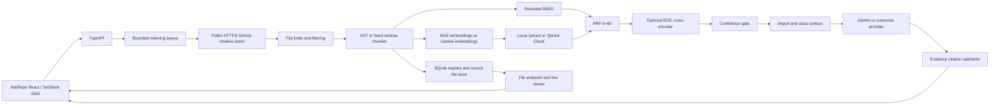

# Architecture and limits

## Architecture

Indexing workers are in-process, default concurrency 1, with a bounded queue. Models are loaded lazily; local startup does not index by default; explicitly enabled demo bootstrap runs in the background. Clones and Git metadata are removed after the filtered source store and chunks have been saved. Completed repo metadata, source files, BM25, and local Qdrant survive restarts when the backend data directory is preserved; ephemeral hosting can discard that directory. Interrupted indexing is marked failed; indexing jobs themselves are ephemeral.

## Known limitations

There is no authentication, multi-user authorization, distributed queue or distributed rate limiter. Use one application process per embedded Qdrant directory; stop the API before running local pre-indexing against that same directory. Multiple workers need a different job architecture and shared metadata/file storage even with Qdrant Cloud. Server-side indexing state and browser chat history have different lifetimes.

Model tokenizers may truncate an approximately 1,500-token chunk: BGE and the reranker currently cap input at their supported sequence lengths. Chunk character budgets and confidence thresholds are heuristic. Dynamic int8 is an optional CPU profile and can change rankings. Draft relevance labels require human correction. Structural citation validity does not prove that a claim follows from those lines. Gemini and Gemini embedding live calls require a user-provided key and provider availability; automated tests stub them. Streaming uses the Gemini async API or explicitly labeled source excerpts. Stop closes the provider stream; a native CPU operation already running finishes before cancellation checkpoints prevent subsequent stages.

The original frontend was a blank Lovable TanStack Start starter. Product metadata is in `src/routes/__root.tsx` rather than `index.html`; theme variables are in `src/theme.css`. A one-time migration moves legacy browser keys to `askrepo:` without overwriting newer values. The advanced interface was added at the user's request; Lovable connection instructions in `frontend/AGENTS.md` are retained.

